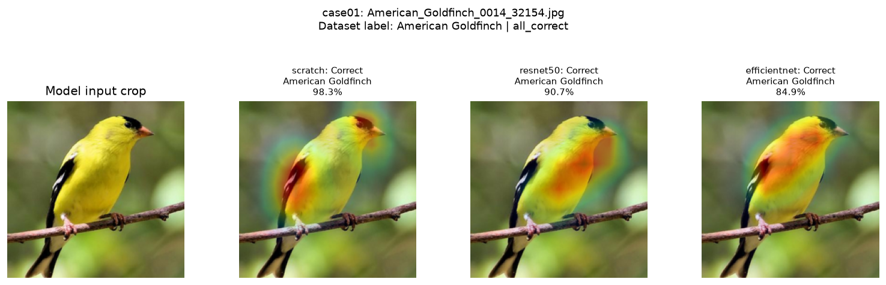
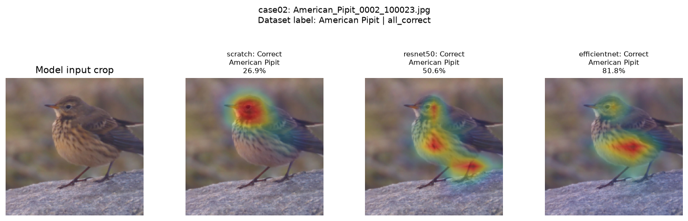
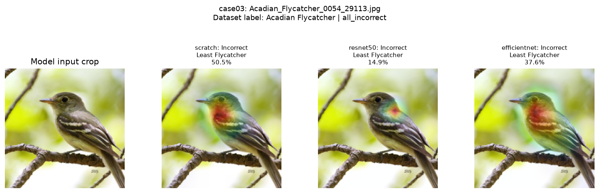
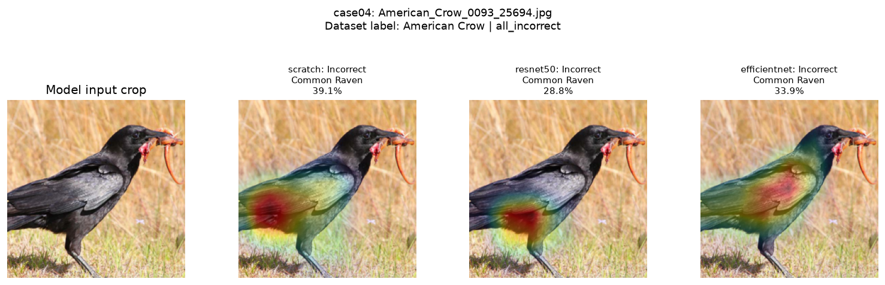
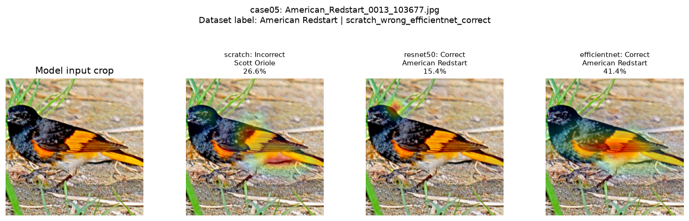
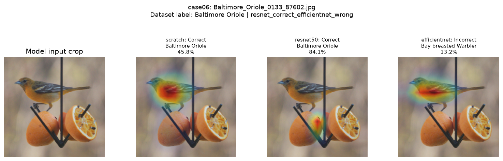

# Grad-CAM: implementation, verification, and labeled comparisons

Grad-CAM now works through `python -m src.cli predict --gradcam` for the scratch
residual CNN, ResNet-50, and EfficientNet-B0. The selected, already-trained
checkpoints were used without retraining. All three checkpoint SHA-256 hashes
are identical before and after the analysis. The full test suite passes:
**36 tests**.

## How the implementation works

Following [Selvaraju et al., Grad-CAM](https://arxiv.org/abs/1610.02391), the code
takes gradients of a target class's raw logit, averages them spatially to obtain
channel weights, and applies ReLU to the weighted feature-map sum. The result
is interpolated to the model input size and normalized for display. By default,
the target is the predicted species; `--gradcam-class` can select another class.

All project encoders expose a parameter-free `encoder.feature_map` hook after
`forward_features` and before global average pooling. This uses each encoder's
complete final spatial representation, including its residual/activation steps,
instead of selecting a convolution inside one residual branch. The hook adds
no parameters, buffers, or checkpoint keys and leaves the forward values unchanged.
Scratch maps are 14 x 14; the ResNet and EfficientNet maps are 7 x 7, before
upsampling to 224 x 224. Models remain in evaluation mode, so BatchNorm running
statistics stay fixed. `autograd.grad` reads feature gradients without filling
parameter `.grad` fields; no optimizer is created or stepped.

The displayed image is reconstructed from the actual normalized input tensor.
This preserves the checkpoint's resize, center crop, and normalization and avoids
incorrectly stretching a cropped heatmap over the full original photograph.
Every standalone comparison also shows the full original image for context.

## Models and verification

| Model | Selected checkpoint source | Preprocessing | State and file checks |
|---|---|---|---|
| Scratch residual CNN | [W&B run d4zbwocv](https://forge.coreweave.com/wandb/deep_learning_birds/multimodal-bird-vision/runs/d4zbwocv), artifact `d4zbwocv-best_model:v0` | 224, dataset normalization | Passed |
| ResNet-50, frozen/light trial 1 | `outputs/cls_resnet50_frozen_20261029-034949/best.pt`, epoch 16 | 224, ImageNet normalization | Passed |
| EfficientNet-B0, frozen/light MLP | [W&B run 28eaem6s](https://forge.coreweave.com/wandb/deep_learning_birds/multimodal-bird-vision/runs/28eaem6s), artifact `28eaem6s-best_model:v0` | 224, ImageNet normalization | Passed |

The real-model checks compare every parameter and buffer before/after Grad-CAM,
check that parameter gradients remain untouched, compare the logits with an
ordinary forward pass, and hash every checkpoint before and after all CLI calls.
Full hashes and boolean results are saved in
[results.json](../reports/gradcam/results.json).

Automated tests also check that two target classes highlight different known
regions in a synthetic example, zero positive evidence produces a finite zero
map, fully frozen encoders work for all three architectures, hooks are removed
on errors, and the CLI saves readable artifacts without modifying its checkpoint.
The CLI test verifies inverse normalization against known RGB values.

## Selection of labeled images

The script first runs ordinary FP32 inference on the fixed **599-image validation
split**, using each checkpoint's saved preprocessing and class-name mapping.
It then selects six distinct species deterministically by filename, using only
prediction correctness, not heatmap appearance:

- Two examples all models classify correctly.
- Two examples all models classify incorrectly.
- One example scratch gets wrong and EfficientNet gets right.
- One example ResNet gets right and EfficientNet gets wrong.

The labels come from the cached CUB dataset. Original decoded images are exported
losslessly as PNG, so the prediction CLI sees the same pixels as selection.
No test-set model selection or model updates are performed. The correctness
conditions deliberately balance kinds of example; **six selected examples are
not an accuracy estimate or a representative ranking of the models**.

For each image, all three predicted-class maps are generated through the project
CLI. For each of the eight incorrect predictions, a second CLI call explains the
true class. This produces **18 predicted-class maps and 8 true-class maps**.

## Visual observations

These are qualitative readings of the generated figures. A warm region shows
relatively high positive evidence for the chosen class at this feature layer;
it does not prove a causal decision rule or identify an exact anatomical part.

### Case 1: American Goldfinch, all correct



Scratch predicts Goldfinch at 98.3%, ResNet at 90.7%, and EfficientNet at 84.9%.
All maps overlap the bird. Scratch emphasizes the dark wing region and head;
ResNet emphasizes the yellow chest/body with some spread beyond the silhouette;
EfficientNet emphasizes upper body and wing. These are plausible bird-related
regions for this example, rather than a strong hotspot on the distant background.

### Case 2: American Pipit, all correct



Scratch is correct at only 26.9%, ResNet at 50.6%, and EfficientNet at 81.8%.
Scratch's strongest region is the head. ResNet highlights head/chest and the
lower body/leg area; EfficientNet highlights the streaked lower chest/body, with
a smaller region near the head. The models use visibly different portions of
the same bird. Being correct does not imply equally high confidence.

### Case 3: Acadian Flycatcher, all predict Least Flycatcher



Scratch predicts Least Flycatcher at 50.5%, ResNet at 14.9%, and EfficientNet at
37.6%. Their strongest regions are on the head/neck/upper body, rather than
far-off background. This is an important failure case: the bird is localized,
but the selected species is wrong. Distinguishing similar-looking species needs
more than finding a bird-shaped region.

The [ResNet true-class contrast](../reports/gradcam/case03_resnet50_true_class.png)
shifts evidence toward a small region around the bill/face boundary and the
lower wing/tail area. Some evidence extends into adjacent background. This is
the response for Acadian Flycatcher, not a corrected prediction; the model's
top prediction remains Least Flycatcher.

### Case 4: American Crow, all predict Common Raven



Scratch, ResNet, and EfficientNet predict Common Raven at 39.1%, 28.8%, and
33.9%, respectively. The strongest areas lie around the wing/body, with scratch
and ResNet emphasizing lower/rear portions and EfficientNet a broader wing area.
The head and bill are less emphasized in these predicted-class maps. This
suggests a useful question for further investigation: do broad dark-body cues
outweigh finer identifying details? The heatmaps alone cannot establish that
cause, and the models do attend to the bird rather than only the grass.

### Case 5: American Redstart, scratch wrong and transfer models correct



Scratch predicts Scott Oriole at 26.6%; ResNet predicts American Redstart at
15.4%; EfficientNet predicts American Redstart at 41.4%. Scratch emphasizes
the wing/orange patch and some adjacent ground; EfficientNet also emphasizes
the wing/orange region but assigns the correct species. ResNet's strongest
small region is near the head/grass boundary. Similar-looking heatmaps can
therefore accompany different decisions, and a correct prediction can still
include contextual evidence.

The [scratch true-class map](../reports/gradcam/case05_scratch_true_class.png)
shifts evidence toward the neck/upper body and wing boundary. It contrasts two
class scores on the same fixed image; it does not retrain or fix the classifier.

### Case 6: Baltimore Oriole, EfficientNet wrong



Scratch predicts Baltimore Oriole at 45.8%, and ResNet at 84.1%. EfficientNet
predicts Bay-breasted Warbler at only 13.2%. Scratch and EfficientNet both
emphasize the bird's body/wing, despite different predicted labels. ResNet's
strongest hotspot is on the orange/feeder below the bird, not the bird itself.
This is a concrete example of a correct result with potentially distracting
contextual evidence; confidence and correctness do not validate localization.

The [EfficientNet true-class map](../reports/gradcam/case06_efficientnet_true_class.png)
also emphasizes the orange/feeder and a smaller area at the bird's neck. This
raises a context-reliance hypothesis, but a controlled intervention or a larger
localization study would be needed to test it.

## Interpretation limits

Maps are normalized independently per image and class; red does not mean the
same absolute evidence across models. The 7 x 7 / 14 x 14 maps are coarse,
and interpolation does not create feather-level detail. No bounding boxes or
segmentation masks were used to quantify bird/background overlap, so the visual
observations are not localization scores. A bird-focused map can still accompany
a wrong species; a correct prediction can use context. These examples support
discussion of failure modes, not a claim that any model always attends correctly.

## Reproduce through the CLI

From the repository root, with the project environment active:

```powershell
# Predicted-class explanation for the labeled American Goldfinch example.
python -m src.cli predict --config configs/cls_scratch_residual.yaml --ckpt outputs/gradcam_checkpoints/scratch/best.pt --image reports/gradcam/images/case01.png --gradcam --label 46
python -m src.cli predict --config configs/cls_resnet50.yaml --ckpt outputs/cls_resnet50_frozen_20261029-034949/best.pt --image reports/gradcam/images/case01.png --gradcam --label 46
python -m src.cli predict --config configs/cls_efficientnet.yaml --ckpt outputs/gradcam_checkpoints/efficientnet/best.pt --image reports/gradcam/images/case01.png --gradcam --label 46

# Explain the true Baltimore Oriole class, despite an incorrect prediction.
python -m src.cli predict --config configs/cls_efficientnet.yaml --ckpt outputs/gradcam_checkpoints/efficientnet/best.pt --image reports/gradcam/images/case06.png --gradcam --label 94 --gradcam-class 94

# Regenerate selection, comparisons, true-class contrasts, and integrity checks.
python scripts/analyze_gradcam.py

# Regression suite (no real-model retraining).
python -m pytest tests -q -p no:cacheprovider
```

On Windows, `python` can be replaced with `.\.venv\Scripts\python.exe`. The
analysis script accepts `--scratch`, `--resnet50`, `--efficientnet`, `--data-dir`,
`--device`, and `--output-dir` overrides for other machines. Restore the selected
checkpoints from the team's W&B artifacts or shared model files before running;
weights and the dataset are excluded from Git. Each prediction call creates a
unique output folder and returns all artifact paths as JSON. The report keeps
the comparison figures and six labeled source images; raw maps and individual
metadata stay under `outputs/gradcam_analysis/`. Nothing is uploaded to W&B by
these prediction/analysis commands.

The exact figures, labels, model configs, per-case predictions, raw metadata
references, and full before/after checkpoint hashes are recorded in
[results.json](../reports/gradcam/results.json). Its `validation_correct_counts_fp32`
field describes the candidate scan used for image selection, not a replacement
for the already-reported test metrics.
